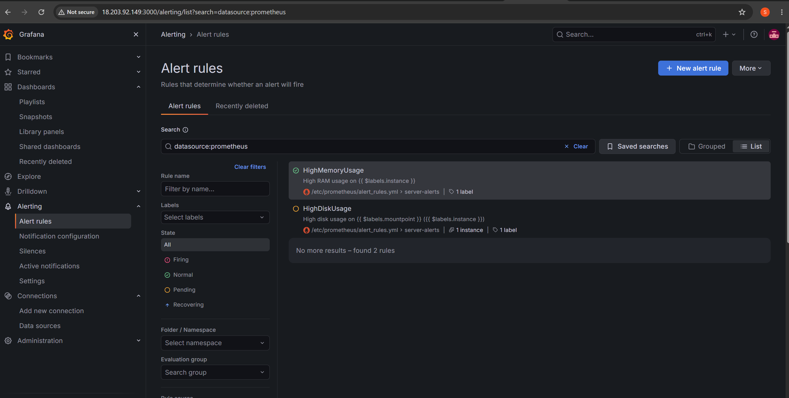
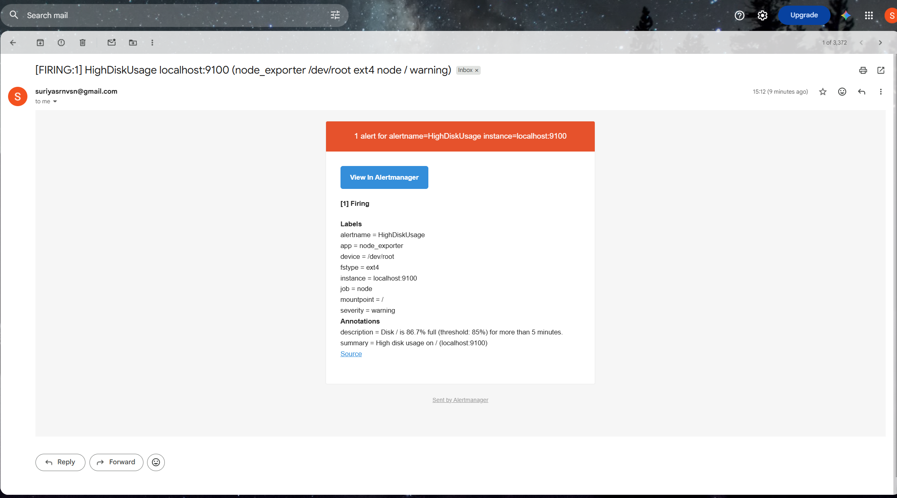

# Email Alerts with Prometheus Alertmanager and Gmail

This guide sets up **email alerts** for the EC2 server:

| Alert | Condition | Email sent when |
|---|---|---|
| **HighMemoryUsage** | RAM utilization **> 65%** | The condition has been true for **5 minutes** |
| **HighDiskUsage** | Disk usage **> 85%** on any real filesystem | The condition has been true for **5 minutes** |

A second email (**RESOLVED**) is sent once the value drops back below the threshold.

Every command comes with an explanation of what it does and why it's needed.

> **Before you start:** Complete these guides first:
> 1. [Prometheus_Installation_Steps.md](Prometheus_Installation_Steps.md)
> 2. [Grafana_Installation_Steps.md](Grafana_Installation_Steps.md)
> 3. [Node_Exporter_Installation_Steps.md](Node_Exporter_Installation_Steps.md)

---

## Table of Contents

1. [How alerting works](#1-how-alerting-works)
2. [Files in this repository](#2-files-in-this-repository)
3. [Step 1 – Create a Gmail App Password](#step-1--create-a-gmail-app-password)
4. [Step 2 – Create a user and directories](#step-2--create-a-user-and-directories)
5. [Step 3 – Download and install Alertmanager](#step-3--download-and-install-alertmanager)
6. [Step 4 – Store the Gmail App Password](#step-4--store-the-gmail-app-password)
7. [Step 5 – Create the Alertmanager config](#step-5--create-the-alertmanager-config)
8. [Step 6 – Create the Alertmanager service](#step-6--create-the-alertmanager-service)
9. [Step 7 – Start Alertmanager](#step-7--start-alertmanager)
10. [Step 8 – Send a test email](#step-8--send-a-test-email)
11. [Step 9 – Create the alert rules](#step-9--create-the-alert-rules)
12. [Step 10 – Connect Prometheus to Alertmanager](#step-10--connect-prometheus-to-alertmanager)
13. [Step 11 – Check that the alerts work](#step-11--check-that-the-alerts-work)
14. [Step 12 – (Optional) Add Alertmanager to the Services panel](#step-12--optional-add-alertmanager-to-the-services-panel)
15. [Changing thresholds or adding alerts](#changing-thresholds-or-adding-alerts)
16. [Useful commands](#useful-commands)
17. [Troubleshooting](#troubleshooting)
18. [Uninstall Alertmanager](#uninstall-alertmanager)

---

## 1. How alerting works

```
 ┌──────────────────── EC2 t3.micro (Ubuntu) ─────────────────────┐
 │                                                                │
 │  Node Exporter :9100 ──► Prometheus :9090                      │
 │                          │  evaluates alert_rules.yml every 15s│
 │                          │  condition true for 5m → FIRING     │
 │                          ▼                                     │
 │                    Alertmanager 127.0.0.1:9093                 │
 │                          │  groups, de-duplicates, repeats 4h  │
 └──────────────────────────┼─────────────────────────────────────┘
                            │ SMTP over TLS (port 587)
                            ▼
                     smtp.gmail.com  ──►  📧 suriyasrnvsn@gmail.com
```

| Component | Job |
|---|---|
| **Prometheus** | Evaluates the **alert rules** (PromQL conditions). When a condition has been true for the `for:` duration, the alert becomes **FIRING** and is sent to Alertmanager. |
| **Alertmanager** | Receives alerts, **groups** them, **removes duplicates**, decides **when to repeat** them, and sends **notifications** (email here; Slack, Teams, etc. are also supported). |
| **Gmail SMTP** | The mail server that actually delivers the email. |

### Alert states

| State | Meaning |
|---|---|
| **Inactive** | Condition is false. Everything is OK. |
| **Pending** | Condition is true, but not yet for the full `for: 5m`. No email yet. This avoids alerts for short spikes. |
| **Firing** | Condition has been true for 5 minutes. **An email is sent.** |

---

## 2. Files in this repository

| File | Copy to (on the server) | Purpose |
|---|---|---|
| [`prometheus/alertmanager.yml`](prometheus/alertmanager.yml) | `/etc/alertmanager/alertmanager.yml` | Alertmanager config: Gmail SMTP settings, routing, recipient |
| [`prometheus/alertmanager.service`](prometheus/alertmanager.service) | `/etc/systemd/system/alertmanager.service` | systemd service for Alertmanager |
| [`prometheus/alert_rules.yml`](prometheus/alert_rules.yml) | `/etc/prometheus/alert_rules.yml` | The RAM and disk alert rules |
| [`prometheus/prometheus.yml`](prometheus/prometheus.yml) | `/etc/prometheus/prometheus.yml` | Updated Prometheus config: loads the rules, sends alerts to Alertmanager, scrapes Alertmanager |

> 🔒 **The Gmail App Password is NOT in any of these files.** It's stored only on the server in `/etc/alertmanager/gmail_app_password`, so it is never pushed to GitHub. **Never commit passwords to Git.**

---

## Step 1 – Create a Gmail App Password

Gmail doesn't accept your normal password from other programs. You need an **App Password**: a 16-character password that only works for sending mail from this program and can be revoked at any time.

1. Turn on **2-Step Verification** for the Gmail account: <https://myaccount.google.com/security>. App Passwords only exist when 2-Step Verification is on.
2. Open <https://myaccount.google.com/apppasswords>.
3. Under **App name**, type `Alertmanager` and click **Create**.
4. Google shows a 16-character password like `abcd efgh ijkl mnop`. **Copy it.** You can't view it again later. If you lose it, delete it and create a new one.

> If the App Passwords page says *"The setting you are looking for is not available"*, 2-Step Verification is off, or the account is a work/school account where the admin has disabled App Passwords.

---

## Step 2 – Create a user and directories

```bash
sudo useradd --no-create-home --shell /usr/sbin/nologin alertmanager
sudo mkdir -p /etc/alertmanager /var/lib/alertmanager
```

| Command | Explanation |
|---|---|
| `useradd ... alertmanager` | Creates a non-login system user to run Alertmanager (least privilege, as with the other services). |
| `mkdir -p /etc/alertmanager` | Directory for the **configuration** and the password file. |
| `mkdir -p /var/lib/alertmanager` | Directory where Alertmanager stores its **state**: active silences and which notifications were already sent. |

---

## Step 3 – Download and install Alertmanager

> ⚠️ Download into your **home folder (`~`)**, not `/tmp`. On this server `/tmp` is a small, RAM-based `tmpfs` with a per-user limit, and large downloads fail with *"Disk quota exceeded"*.

```bash
cd ~
AM_VERSION=$(curl -s https://api.github.com/repos/prometheus/alertmanager/releases/latest | grep '"tag_name"' | cut -d '"' -f4 | sed 's/^v//')
echo "Installing Alertmanager $AM_VERSION"
wget https://github.com/prometheus/alertmanager/releases/download/v${AM_VERSION}/alertmanager-${AM_VERSION}.linux-amd64.tar.gz
tar xvf alertmanager-${AM_VERSION}.linux-amd64.tar.gz
sudo cp alertmanager-${AM_VERSION}.linux-amd64/alertmanager alertmanager-${AM_VERSION}.linux-amd64/amtool /usr/local/bin/
sudo chown alertmanager:alertmanager /usr/local/bin/alertmanager /usr/local/bin/amtool
sudo chown -R alertmanager:alertmanager /etc/alertmanager /var/lib/alertmanager
alertmanager --version
rm -rf ~/alertmanager-*
```

| Command | Explanation |
|---|---|
| `AM_VERSION=$(curl ... \| sed 's/^v//')` | Gets the latest Alertmanager version from GitHub (same technique as the other guides). |
| `wget` / `tar xvf` | Downloads and extracts the Linux x86_64 release. |
| `cp alertmanager amtool /usr/local/bin/` | Installs two binaries. **`alertmanager`** is the server. **`amtool`** is a command-line tool to check configs, send test alerts and manage silences. |
| `chown ...` | Gives the `alertmanager` user ownership of the binaries and directories. |
| `alertmanager --version` | Confirms the install. |
| `rm -rf ~/alertmanager-*` | Deletes the downloaded archive and folder to free disk space. |

---

## Step 4 – Store the Gmail App Password

```bash
read -rsp "Paste Gmail App Password: " APP_PW; echo
printf '%s' "${APP_PW// /}" | sudo tee /etc/alertmanager/gmail_app_password > /dev/null
unset APP_PW
sudo chown alertmanager:alertmanager /etc/alertmanager/gmail_app_password
sudo chmod 600 /etc/alertmanager/gmail_app_password
```

| Command | Explanation |
|---|---|
| `read -rsp "..." APP_PW` | Asks for the password and stores it in the variable `APP_PW`. `-s` = **silent** (not shown on screen), `-p` = prompt text, `-r` = take backslashes literally. Typing it at a prompt also keeps it **out of the shell history** (`~/.bash_history`). |
| `echo` | Moves to a new line after the hidden input. |
| `${APP_PW// /}` | Removes all **spaces**. Google displays the password as `abcd efgh ijkl mnop`, but the real password is `abcdefghijklmnop`. |
| `printf '%s' ... \| sudo tee <file>` | Writes the password into the file as root, **without a trailing newline**. |
| `unset APP_PW` | Deletes the variable from the shell's memory. |
| `chown alertmanager:alertmanager` | Only the Alertmanager service user owns the file. |
| `chmod 600` | Only the owner can read or write it. Other users on the server can't see the password. |

---

## Step 5 – Create the Alertmanager config

```bash
sudo nano /etc/alertmanager/alertmanager.yml
```

Paste the contents of [`prometheus/alertmanager.yml`](prometheus/alertmanager.yml), then press **`Ctrl+O`**, **`Enter`**, **`Ctrl+X`**. Then:

```bash
sudo chown alertmanager:alertmanager /etc/alertmanager/alertmanager.yml
amtool check-config /etc/alertmanager/alertmanager.yml
```

| Command | Explanation |
|---|---|
| `chown` | The service user must be able to read the config. |
| `amtool check-config <file>` | Checks the config. It should print **`SUCCESS`** and list `1 receivers` and `0 templates`. |

### What the config means

```yaml
global:
  smtp_smarthost: 'smtp.gmail.com:587'
  smtp_from: 'suriyasrnvsn@gmail.com'
  smtp_auth_username: 'suriyasrnvsn@gmail.com'
  smtp_auth_password_file: '/etc/alertmanager/gmail_app_password'
  smtp_require_tls: true
```

| Setting | Explanation |
|---|---|
| `smtp_smarthost` | Gmail's SMTP server. Port **587** uses STARTTLS. AWS blocks outbound port **25** by default, but **587 is allowed**. |
| `smtp_from` | The sender address shown in the email. For Gmail it must be the same account (or an alias of it). |
| `smtp_auth_username` | The Gmail account used to log in to SMTP. |
| `smtp_auth_password_file` | Reads the App Password from a separate file, so this config file contains no secrets and is safe to commit. |
| `smtp_require_tls` | The connection to Gmail must be encrypted. |

```yaml
route:
  receiver: 'email'
  group_by: ['alertname', 'instance']
  group_wait: 30s
  group_interval: 5m
  repeat_interval: 4h
```

| Setting | Explanation |
|---|---|
| `receiver: 'email'` | By default, send all alerts to the receiver named `email`. |
| `group_by` | Alerts with the same `alertname` and `instance` are combined into **one email** instead of many. |
| `group_wait: 30s` | After the first alert of a new group arrives, wait 30 s to collect related alerts, then send one email. |
| `group_interval: 5m` | If new alerts join an existing group, wait at least 5 minutes before sending an updated email. |
| `repeat_interval: 4h` | If an alert is **still firing**, send a reminder every 4 hours. Without this you'd get only one email. |

```yaml
receivers:
  - name: 'email'
    email_configs:
      - to: 'suriyasrnvsn@gmail.com'
        send_resolved: true
```

| Setting | Explanation |
|---|---|
| `to` | Recipient. For several, use commas: `'a@x.com, b@y.com'`. |
| `send_resolved: true` | Also sends a **RESOLVED** email when the problem goes away. |

---

## Step 6 – Create the Alertmanager service

```bash
sudo nano /etc/systemd/system/alertmanager.service
```

Paste the contents of [`prometheus/alertmanager.service`](prometheus/alertmanager.service), then save and exit (**`Ctrl+O`**, **`Enter`**, **`Ctrl+X`**).

| Line / flag | Explanation |
|---|---|
| `User=` / `Group=alertmanager` | Runs as the non-root user from Step 2. |
| `--config.file=/etc/alertmanager/alertmanager.yml` | Path to the config. |
| `--storage.path=/var/lib/alertmanager` | Where state (silences, notification log) is stored. |
| `--web.listen-address=127.0.0.1:9093` | Listens on **localhost only**. Only Prometheus on the same server needs to reach it, so **no Security Group rule is needed**. |
| `--cluster.listen-address=` | An **empty** value **turns off clustering**. Clustering is only for running several Alertmanagers together (high availability). Otherwise it would open an extra port, 9094. |
| `ExecReload=/bin/kill -HUP $MAINPID` | `systemctl reload alertmanager` reloads the config without a restart. |
| `Restart=on-failure` | Restarts automatically if it crashes. |

---

## Step 7 – Start Alertmanager

```bash
sudo systemctl daemon-reload
sudo systemctl enable --now alertmanager
sudo systemctl status alertmanager
curl -s localhost:9093/-/ready
```

| Command | Explanation |
|---|---|
| `daemon-reload` | Loads the new unit file. |
| `enable --now` | Starts it now and at every boot. |
| `status` | Should show **`active (running)`**. Press `q` to exit. |
| `curl -s localhost:9093/-/ready` | Readiness check. Should print **`OK`**. |

---

## Step 8 – Send a test email

Before relying on real alerts, confirm that email delivery works by sending a **fake alert** straight to Alertmanager:

```bash
amtool alert add TestAlert severity=test instance=manual-test \
  --annotation=summary="Test alert from Alertmanager" \
  --annotation=description="If you received this email, alerting works." \
  --alertmanager.url=http://localhost:9093
```

| Part | Explanation |
|---|---|
| `amtool alert add TestAlert` | Creates an alert named `TestAlert`. |
| `severity=test instance=manual-test` | Labels attached to the alert. |
| `--annotation=summary=...` / `description=...` | Text that appears in the email. |
| `--alertmanager.url=http://localhost:9093` | Which Alertmanager to send it to. |

Within about **30 seconds** (`group_wait`) you should receive an email with the subject **`[FIRING:1] TestAlert ...`**. **Check the Spam folder** too. If it's there, mark it as *Not spam*.

The test alert expires on its own after about 5 minutes. Because `send_resolved: true` is set, you may then also get a **RESOLVED** email.

If no email arrives, check the logs:

```bash
sudo journalctl -u alertmanager -n 30 --no-pager
```

See [Troubleshooting](#troubleshooting) for common errors.

---

## Step 9 – Create the alert rules

```bash
sudo nano /etc/prometheus/alert_rules.yml
```

Paste the contents of [`prometheus/alert_rules.yml`](prometheus/alert_rules.yml), then save and exit. Then:

```bash
sudo chown prometheus:prometheus /etc/prometheus/alert_rules.yml
promtool check rules /etc/prometheus/alert_rules.yml
```

| Command | Explanation |
|---|---|
| `chown prometheus:prometheus` | Prometheus must be able to read the rules file. |
| `promtool check rules <file>` | Checks the syntax and PromQL. Should print **`SUCCESS: 2 rules found`**. |

### What the rules mean

```yaml
- alert: HighMemoryUsage
  expr: 100 * (1 - node_memory_MemAvailable_bytes{job="node"} / node_memory_MemTotal_bytes{job="node"}) > 65
  for: 5m
```

| Field | Explanation |
|---|---|
| `alert` | The alert's name. It appears in the email subject. |
| `expr` | A PromQL condition. **RAM used %** = `100 × (1 − available / total)`. It's the same formula as the dashboard's *RAM Used* gauge. The alert is active while the result is `> 65`. |
| `for: 5m` | The condition must stay true for **5 minutes** before the email is sent. Short spikes (e.g. during `apt upgrade`) don't trigger emails. |
| `labels.severity` | A label you can use for routing (e.g. send `critical` alerts to a different address). |
| `annotations.summary` / `description` | Text in the email. `{{ $labels.instance }}` and `{{ $labels.mountpoint }}` insert label values. `{{ $value \| printf "%.1f" }}` inserts the current value rounded to 1 decimal place. |

```yaml
- alert: HighDiskUsage
  expr: 100 * (1 - node_filesystem_avail_bytes{...} / node_filesystem_size_bytes{...}) > 85
  for: 5m
```

**Disk used %** for each real filesystem (`/`, `/boot`, `/boot/efi`). In-memory filesystems (`tmpfs`) and snap packages (`squashfs`) are excluded by the `fstype!~"..."` filter. Each filesystem over 85% raises its own alert.

---

## Step 10 – Connect Prometheus to Alertmanager

Replace `/etc/prometheus/prometheus.yml` with the updated [`prometheus/prometheus.yml`](prometheus/prometheus.yml):

```bash
sudo cp /etc/prometheus/prometheus.yml /etc/prometheus/prometheus.yml.bak
sudo truncate -s 0 /etc/prometheus/prometheus.yml
sudo nano /etc/prometheus/prometheus.yml
```

Paste the file contents, save and exit. Then validate and reload:

```bash
promtool check config /etc/prometheus/prometheus.yml
sudo systemctl reload prometheus
```

`promtool check config` also checks the rule file. It should print **`SUCCESS`** for both the config and `alert_rules.yml`.

### What changed in `prometheus.yml`

```yaml
alerting:
  alertmanagers:
    - static_configs:
        - targets: ["localhost:9093"]

rule_files:
  - "alert_rules.yml"
```

| Section | Explanation |
|---|---|
| `alerting.alertmanagers` | Where Prometheus sends firing alerts: Alertmanager on `localhost:9093`. |
| `rule_files` | Which rule files to load. The path is **relative to the config file's folder**, so this means `/etc/prometheus/alert_rules.yml`. |
| New `alertmanager` scrape job | Prometheus also collects Alertmanager's own metrics. It appears as a 4th target in the dashboard's **Scrape Targets** panel. |

---

## Step 11 – Check that the alerts work

### Check from the server

```bash
curl -s localhost:9090/api/v1/rules | grep -o '"name":"[A-Za-z]*","query\|"state":"[a-z]*"'
curl -s localhost:9090/api/v1/alertmanagers | grep -o '"url":"[^"]*"'
```

| Command | Explanation |
|---|---|
| `.../api/v1/rules` | Lists the loaded rules and their state (`inactive`, `pending`, `firing`). You should see `HighMemoryUsage` and `HighDiskUsage`. |
| `.../api/v1/alertmanagers` | Shows which Alertmanager Prometheus is sending to. Expected: `http://localhost:9093/api/v2/alerts`. |

### Check in the browser

- **Grafana:** **Alerting → Alert rules**. Under **Data source-managed**, you'll see both rules with their current state.
- **Prometheus UI** (if port 9090 is open): the **Alerts** page shows both rules as **Inactive** (green), **Pending** (yellow) or **Firing** (red).



### Seeing an alert fire

If the root disk is already above 85% (e.g. the default 8 GB EBS volume), **HighDiskUsage** will go **Pending** right away, **Firing** after 5 minutes, and you'll get the email. That's the alert working correctly. Fix it by freeing space or **increasing the EBS volume size**:

```bash
sudo apt clean                          # delete cached .deb package files
sudo journalctl --vacuum-size=100M      # shrink system logs to 100 MB
```

To grow the disk: **EC2 → Volumes → Modify volume** → new size, then on the server:

```bash
sudo growpart /dev/nvme0n1 1     # grow partition 1 to fill the bigger disk
sudo resize2fs /dev/root         # grow the ext4 filesystem to fill the partition
df -h /
```

The email you receive looks like this:

Subject: **`[FIRING:1] HighDiskUsage localhost:9100 (node_exporter /dev/root ext4 node / warning)`**



| Part of the email | Where it comes from |
|---|---|
| Subject `[FIRING:1] HighDiskUsage ...` | Alert state, number of alerts, alert name and the alert's labels |
| **Labels** | The labels on the alert. `device`, `fstype` and `mountpoint` come from the Node Exporter metric; `severity` comes from `alert_rules.yml`. |
| **Annotations** | The `summary` and `description` templates from `alert_rules.yml`, filled in with real values |
| **View In Alertmanager** / **Source** | Links to Alertmanager and Prometheus. They point to the server's internal hostname and won't open from your laptop, which is expected because both listen only on localhost or are closed in the Security Group. |

Once usage drops below 85%, you'll receive a **RESOLVED** email.

> **About the 65% RAM threshold on a `t3.micro`:** With only 1 GB of RAM, Ubuntu + Prometheus + Grafana + Alertmanager can sit close to 65% under normal conditions, so this alert may fire often. If it does, either raise the threshold (e.g. to 80) or use a bigger instance.

---

## Step 12 – (Optional) Add Alertmanager to the Services panel

The dashboard's **Services** panel only shows services listed in Node Exporter's `--collector.systemd.unit-include`. The repository's [`prometheus/node_exporter.service`](prometheus/node_exporter.service) already includes `alertmanager`. To apply it on the server:

```bash
sudo sed -i 's/(prometheus|grafana-server|node_exporter)/(prometheus|grafana-server|node_exporter|alertmanager)/' /etc/systemd/system/node_exporter.service
sudo systemctl daemon-reload
sudo systemctl restart node_exporter
```

| Command | Explanation |
|---|---|
| `sed -i 's/old/new/' <file>` | Edits the file in place, adding `alertmanager` to the list of monitored services. |
| `daemon-reload` + `restart` | Applies the changed service file. |

---

## Changing thresholds or adding alerts

1. Edit the rules: `sudo nano /etc/prometheus/alert_rules.yml` (e.g. change `> 65` to `> 80`).
2. Validate: `promtool check rules /etc/prometheus/alert_rules.yml`.
3. Apply without a restart: `sudo systemctl reload prometheus`.

Example of an extra rule, alerting when a scrape target is down:

```yaml
      - alert: TargetDown
        expr: up == 0
        for: 2m
        labels:
          severity: critical
        annotations:
          summary: 'Target {{ $labels.job }} is down'
          description: 'Prometheus cannot scrape {{ $labels.instance }} (job {{ $labels.job }}) for more than 2 minutes.'
```

---

## Useful commands

| Task | Command |
|---|---|
| Alertmanager status | `sudo systemctl status alertmanager` |
| Alertmanager logs | `sudo journalctl -u alertmanager -f` |
| Validate the Alertmanager config | `amtool check-config /etc/alertmanager/alertmanager.yml` |
| Reload the Alertmanager config | `sudo systemctl reload alertmanager` |
| Validate the alert rules | `promtool check rules /etc/prometheus/alert_rules.yml` |
| Reload rules | `sudo systemctl reload prometheus` |
| List alerts currently in Alertmanager | `amtool alert query --alertmanager.url=http://localhost:9093` |
| Send a test alert | See [Step 8](#step-8--send-a-test-email) |
| Silence an alert for 2 hours (e.g. during maintenance) | `amtool silence add alertname=HighDiskUsage --duration=2h --comment="maintenance" --alertmanager.url=http://localhost:9093` |
| List silences | `amtool silence query --alertmanager.url=http://localhost:9093` |
| Remove a silence | `amtool silence expire <SILENCE_ID> --alertmanager.url=http://localhost:9093` |
| Change the Gmail App Password | Repeat [Step 4](#step-4--store-the-gmail-app-password), then `sudo systemctl restart alertmanager` |

---

## Troubleshooting

### No test email received

Check the logs first: `sudo journalctl -u alertmanager -n 30 --no-pager`

| Error in logs | Cause / Fix |
|---|---|
| `535 5.7.8 Username and Password not accepted` | Wrong App Password, or your **normal** Gmail password was used. Create a new App Password and repeat [Step 4](#step-4--store-the-gmail-app-password). |
| `534 5.7.9 Application-specific password required` | 2-Step Verification is on, but an App Password wasn't used. See Step 1. |
| `open /etc/alertmanager/gmail_app_password: permission denied` | Run `sudo chown alertmanager:alertmanager /etc/alertmanager/gmail_app_password`. |
| `dial tcp ...:587: i/o timeout` | Outbound port 587 is blocked. Check the Security Group **outbound** rules (the default allows all) and any Network ACLs. |
| No errors, but no email | Check the **Spam** folder. Wait 30 s for `group_wait`. Check the `to:` address. |

### Rules not showing in Prometheus

- Run `promtool check config /etc/prometheus/prometheus.yml`. It must list `alert_rules.yml` with `SUCCESS`.
- Check that `rule_files:` in `prometheus.yml` isn't commented out (no `#`).
- Check ownership: `ls -l /etc/prometheus/alert_rules.yml` should show `prometheus prometheus`.
- Reload: `sudo systemctl reload prometheus`.

### Alert is Firing in Prometheus, but no email arrives

- Is Alertmanager running? `curl -s localhost:9093/-/ready` should print `OK`.
- Is Prometheus connected to it? `curl -s localhost:9090/api/v1/alertmanagers` should list `localhost:9093`.
- Is the alert silenced? `amtool silence query --alertmanager.url=http://localhost:9093`.

### Too many emails

- Increase `repeat_interval` in `alertmanager.yml` (e.g. `12h`), then `sudo systemctl reload alertmanager`.
- Increase `for:` in the rules (e.g. `15m`), or raise the threshold.

---

## Uninstall Alertmanager

```bash
sudo systemctl disable --now alertmanager
sudo rm /etc/systemd/system/alertmanager.service
sudo systemctl daemon-reload
sudo rm /usr/local/bin/alertmanager /usr/local/bin/amtool
sudo rm -rf /etc/alertmanager /var/lib/alertmanager
sudo userdel alertmanager
```

Then remove the `alerting:` and `rule_files:` sections and the `alertmanager` scrape job from `/etc/prometheus/prometheus.yml`, and run `sudo systemctl reload prometheus`.

Also delete the App Password at <https://myaccount.google.com/apppasswords>.
