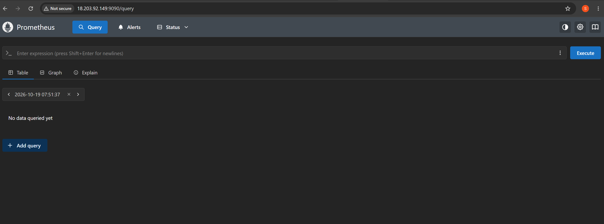

# Installing Prometheus on AWS EC2 (Ubuntu)

This guide installs **Prometheus** on an **AWS EC2 `t3.micro` instance running Ubuntu**. Prometheus runs as a `systemd` service under its own user, and you reach its web UI from your browser.

Every command comes with an explanation of what it does and why it's needed.

> Next guide: [Grafana_Installation_Steps.md](Grafana_Installation_Steps.md). It installs Grafana on the same server and connects it to this Prometheus.

---

## Table of Contents

1. [What is Prometheus?](#1-what-is-prometheus)
2. [Architecture](#2-architecture)
3. [Prerequisites](#3-prerequisites)
4. [Connect to the EC2 instance](#4-connect-to-the-ec2-instance)
5. [Step 1 – Update the system](#step-1--update-the-system)
6. [Step 2 – Create a dedicated user and directories](#step-2--create-a-dedicated-user-and-directories)
7. [Step 3 – Download the latest Prometheus release](#step-3--download-the-latest-prometheus-release)
8. [Step 4 – Install the binaries and config](#step-4--install-the-binaries-and-config)
9. [Step 5 – Review and validate the config file](#step-5--review-and-validate-the-config-file)
10. [Step 6 – Create a systemd service](#step-6--create-a-systemd-service)
11. [Step 7 – Start and enable the service](#step-7--start-and-enable-the-service)
12. [Step 8 – Open port 9090 in the AWS Security Group](#step-8--open-port-9090-in-the-aws-security-group)
13. [Step 9 – Access the Prometheus web UI](#step-9--access-the-prometheus-web-ui)
14. [Useful commands](#useful-commands)
15. [Troubleshooting](#troubleshooting)
16. [Notes](#notes)
17. [Uninstall Prometheus](#uninstall-prometheus)

---

## 1. What is Prometheus?

[Prometheus](https://prometheus.io/) is an open-source monitoring and alerting tool. At a fixed interval it **pulls ("scrapes")** metrics over HTTP from the targets you configure. It stores them in its own **time-series database (TSDB)**, and you query them with **PromQL**.

In this guide Prometheus monitors **itself**, which is the default config. More targets, such as Node Exporter for server CPU, memory and disk, can be added later.

---

## 2. Architecture

```
 Your Laptop (browser)
        │
        │  http://<EC2-Public-IP>:9090
        ▼
 ┌───────────────── AWS Security Group ─────────────────┐
 │  Inbound rule: TCP 9090  ← allowed only from My IP   │
 │                                                      │
 │   EC2 t3.micro (Ubuntu)                              │
 │   ┌──────────────────────────────────────────────┐   │
 │   │ systemd → prometheus.service                 │   │
 │   │   /usr/local/bin/prometheus                  │   │
 │   │   config : /etc/prometheus/prometheus.yml    │   │
 │   │   data   : /var/lib/prometheus               │   │
 │   │   scrapes itself → localhost:9090/metrics    │   │
 │   └──────────────────────────────────────────────┘   │
 └──────────────────────────────────────────────────────┘
```

---

## 3. Prerequisites

| Item | Value used in this guide |
|---|---|
| Cloud | AWS EC2 |
| Instance type | `t3.micro` (2 vCPU, 1 GB RAM, x86_64) |
| OS | Ubuntu (22.04 / 24.04 LTS) |
| Access | EC2 Instance Connect (browser terminal in the AWS Console) |
| Permissions | A user with `sudo` (the default `ubuntu` user) |
| Ports | `9090` (Prometheus web UI / API) |

> **CPU architecture:** `t3` instances are **x86_64**, so this guide downloads the `linux-amd64` build. On a Graviton (ARM) instance such as `t4g`, use `linux-arm64` instead. Check yours with `uname -m`: `x86_64` → amd64, `aarch64` → arm64.

---

## 4. Connect to the EC2 instance

1. Open the **AWS Console → EC2 → Instances**.
2. Select your instance and click **Connect**.
3. On the **EC2 Instance Connect** tab, keep the username `ubuntu` and click **Connect**.

A terminal opens in the browser. Run all of the following commands in it.

---

## Step 1 – Update the system

```bash
sudo apt update && sudo apt upgrade -y
```

| Part | Explanation |
|---|---|
| `sudo` | Runs the command as root (administrator). Installing software needs this. |
| `apt update` | Downloads the latest package lists from Ubuntu's repositories. It doesn't install anything. |
| `&&` | Runs the second command only if the first one succeeded. |
| `apt upgrade -y` | Upgrades installed packages to their latest versions. `-y` answers "yes" to prompts automatically. |

**Why:** A freshly launched instance usually has outdated packages. Updating first picks up security fixes and avoids dependency problems.

> If a purple screen asks which services to restart, press **Enter** to accept the defaults. If a kernel update was installed, you can reboot later with `sudo reboot`.

---

## Step 2 – Create a dedicated user and directories

```bash
sudo useradd --no-create-home --shell /usr/sbin/nologin prometheus
sudo mkdir -p /etc/prometheus /var/lib/prometheus
```

| Part | Explanation |
|---|---|
| `useradd prometheus` | Creates a system user named `prometheus`. |
| `--no-create-home` | Doesn't create `/home/prometheus`. The service doesn't need a home directory. |
| `--shell /usr/sbin/nologin` | Nobody can log in as this user. It exists only to run the service. |
| `mkdir -p` | Creates the directories. `-p` also creates parent directories and doesn't fail if the directory already exists. |
| `/etc/prometheus` | Where the **configuration** (`prometheus.yml`) lives. |
| `/var/lib/prometheus` | Where Prometheus stores its **time-series data** (TSDB). |

**Why:** Running a service as **root** is a security risk. If Prometheus were compromised, the attacker would have full control of the server. A dedicated, non-login user follows the **principle of least privilege**.

---

## Step 3 – Download the latest Prometheus release

> ⚠️ **Download into your home folder (`~`), not `/tmp`.** On newer Ubuntu versions, `/tmp` is a small, RAM-based `tmpfs` (half the RAM, about 455 MB on a `t3.micro`) with a per-user limit. Large downloads there fail with *"Disk quota exceeded"*. Adding swap does **not** raise this limit.

```bash
cd ~
VERSION=$(curl -s https://api.github.com/repos/prometheus/prometheus/releases/latest | grep '"tag_name"' | cut -d '"' -f4 | sed 's/^v//')
echo "Installing Prometheus $VERSION"
wget https://github.com/prometheus/prometheus/releases/download/v${VERSION}/prometheus-${VERSION}.linux-amd64.tar.gz
tar xvf prometheus-${VERSION}.linux-amd64.tar.gz
cd prometheus-${VERSION}.linux-amd64
```

| Command | Explanation |
|---|---|
| `cd ~` | Switches to your home folder (`/home/ubuntu`), which is on the real disk, to download into. |
| `curl -s https://api.github.com/.../releases/latest` | Calls the GitHub API to get details of the **latest stable** Prometheus release as JSON. `-s` hides the progress bar. |
| `grep '"tag_name"'` | Keeps only the line containing the release tag, e.g. `"tag_name": "v3.x.y",`. |
| `cut -d '"' -f4` | Splits that line on `"` and takes the 4th field, `v3.x.y`. |
| `sed 's/^v//'` | Removes the leading `v`, leaving `3.x.y`. |
| `VERSION=$( ... )` | Stores the result in a shell variable named `VERSION`. |
| `echo "Installing Prometheus $VERSION"` | Prints the version so you can check it was detected. **If it prints nothing, see [Troubleshooting](#version-variable-is-empty).** |
| `wget <url>` | Downloads the release archive (`.tar.gz`) for Linux x86_64. |
| `tar xvf <file>` | Extracts the archive. `x` = extract, `v` = list the files, `f` = use this file. |
| `cd prometheus-${VERSION}.linux-amd64` | Enters the extracted folder. |

**Why:** Looking up the version this way means the guide always installs the newest release, with no hard-coded version to go out of date.

The extracted folder contains:

| File | Purpose |
|---|---|
| `prometheus` | The Prometheus server binary |
| `promtool` | A tool that checks config files and rules |
| `prometheus.yml` | A sample/default configuration |
| `LICENSE`, `NOTICE` | License files |

> **Note:** The `VERSION` variable only exists in the current terminal session. If you reconnect, run the `VERSION=...` line again before reusing it.

---

## Step 4 – Install the binaries and config

```bash
sudo cp prometheus promtool /usr/local/bin/
sudo cp prometheus.yml /etc/prometheus/
sudo chown prometheus:prometheus /usr/local/bin/prometheus /usr/local/bin/promtool
sudo chown -R prometheus:prometheus /etc/prometheus /var/lib/prometheus
prometheus --version
```

| Command | Explanation |
|---|---|
| `cp prometheus promtool /usr/local/bin/` | Copies both binaries into `/usr/local/bin`, which is on the system `PATH`, so you can run them from anywhere. |
| `cp prometheus.yml /etc/prometheus/` | Copies the default config into the config directory. |
| `chown prometheus:prometheus <files>` | Makes the `prometheus` user and group the owner of the binaries. |
| `chown -R ...` | Same, but **recursive** (`-R`), for the config and data directories and everything in them. |
| `prometheus --version` | Confirms the install by printing the version, build date and Go version. |

**Why:** The service runs as the `prometheus` user, so that user must be able to **read** the config and **write** to the data directory. Otherwise Prometheus fails to start with `permission denied`.

Clean up the downloaded files. The archive and extracted folder take about 360 MB and aren't needed anymore:

```bash
cd ~
rm -rf ~/prometheus-*
```

---

## Step 5 – Review and validate the config file

```bash
cat /etc/prometheus/prometheus.yml
promtool check config /etc/prometheus/prometheus.yml
```

| Command | Explanation |
|---|---|
| `cat <file>` | Prints the config file to the screen. |
| `promtool check config <file>` | Checks the YAML syntax and Prometheus config rules. It prints `SUCCESS` if the file is valid. |

The default `prometheus.yml` looks roughly like this:

```yaml
global:
  scrape_interval: 15s       # How often to scrape targets
  evaluation_interval: 15s   # How often to evaluate alerting/recording rules

alerting:
  alertmanagers:
    - static_configs:
        - targets:
          # - alertmanager:9093

rule_files:
  # - "first_rules.yml"

scrape_configs:
  - job_name: "prometheus"
    static_configs:
      - targets: ["localhost:9090"]
        labels:
          app: "prometheus"
```

| Section | Meaning |
|---|---|
| `global.scrape_interval` | Prometheus collects metrics from each target every 15 seconds. |
| `global.evaluation_interval` | Rules are evaluated every 15 seconds. |
| `alerting` | Where to send alerts (Alertmanager). Not used yet. |
| `rule_files` | Alerting and recording rule files. Not used yet. |
| `scrape_configs` | The list of **targets** to monitor. By default, Prometheus scrapes **itself** at `localhost:9090/metrics`. |

**Why:** Always validate the config **before** starting or reloading. A typo in YAML stops Prometheus from starting.

---

## Step 6 – Create a systemd service

> ⚠️ **Don't skip this step.** Steps 1–5 only put files on the server. **Nothing is running yet.** Without this service, opening the URL in a browser gives **"This site can't be reached"**.

This file is also in the repository: [`prometheus/prometheus.service`](prometheus/prometheus.service).

Paste the **whole block** at once, from `sudo tee` down to the final `EOF`:

```bash
sudo tee /etc/systemd/system/prometheus.service > /dev/null <<'EOF'
[Unit]
Description=Prometheus Monitoring
Wants=network-online.target
After=network-online.target

[Service]
User=prometheus
Group=prometheus
Type=simple
ExecStart=/usr/local/bin/prometheus \
  --config.file=/etc/prometheus/prometheus.yml \
  --storage.tsdb.path=/var/lib/prometheus \
  --storage.tsdb.retention.time=15d \
  --web.listen-address=0.0.0.0:9090
ExecReload=/bin/kill -HUP $MAINPID
Restart=on-failure

[Install]
WantedBy=multi-user.target
EOF
```

### How the command works

| Part | Explanation |
|---|---|
| `sudo tee <file>` | Writes what it receives to the file **as root**. A plain `>` redirect doesn't work with `sudo`, because the redirect is done by your own (non-root) shell. |
| `> /dev/null` | Stops `tee` from also printing the content to the screen. |
| `<<'EOF' ... EOF` | A **heredoc**: everything between the two `EOF` markers is passed as input. The **quotes** around `'EOF'` stop the shell from expanding `$MAINPID`, so it is written to the file literally. |

### What each line in the service file means

| Line | Explanation |
|---|---|
| `[Unit]` | Describes the service and when it should start. |
| `Description=` | A readable name, shown in `systemctl status`. |
| `Wants=` / `After=network-online.target` | Waits until the network is up before starting. |
| `[Service]` | How to run the process. |
| `User=` / `Group=prometheus` | Runs as the non-root user created in Step 2. |
| `Type=simple` | The process started by `ExecStart` is the main service process. |
| `ExecStart=` | The command that starts Prometheus (flags explained below). |
| `ExecReload=/bin/kill -HUP $MAINPID` | `systemctl reload prometheus` sends a **HUP signal**, which makes Prometheus reload its config **without restarting**. |
| `Restart=on-failure` | Restarts Prometheus automatically if it crashes. |
| `[Install]` / `WantedBy=multi-user.target` | Starts the service at boot, once `systemctl enable` has been run. |

### Prometheus flags

| Flag | Explanation |
|---|---|
| `--config.file=/etc/prometheus/prometheus.yml` | Path to the configuration file. |
| `--storage.tsdb.path=/var/lib/prometheus` | Where metric data is stored on disk. |
| `--storage.tsdb.retention.time=15d` | Keeps data for **15 days**, then deletes older data. This keeps the small EBS disk from filling up. |
| `--web.listen-address=0.0.0.0:9090` | Listens on **all network interfaces**, port 9090, so it can be reached from outside the server, subject to the Security Group. |

---

## Step 7 – Start and enable the service

```bash
sudo systemctl daemon-reload
sudo systemctl enable --now prometheus
sudo systemctl status prometheus
```

| Command | Explanation |
|---|---|
| `systemctl daemon-reload` | Tells systemd to re-read unit files, so it picks up the new `prometheus.service`. |
| `systemctl enable --now prometheus` | `enable` = start automatically at **every boot**. `--now` = also **start it right now**. |
| `systemctl status prometheus` | Shows whether the service is running, its PID, memory use and the latest log lines. |

✅ Expected output includes **`Active: active (running)`**. Press **`q`** to exit the status view.

### Check it on the server

```bash
curl -s localhost:9090/-/ready
sudo ss -tlnp | grep 9090
```

| Command | Explanation |
|---|---|
| `curl -s localhost:9090/-/ready` | Calls Prometheus' readiness endpoint. Expected: `Prometheus Server is Ready.` |
| `ss -tlnp` | Lists listening TCP sockets. `t` = TCP, `l` = listening, `n` = numeric ports, `p` = show the process. |
| `grep 9090` | Keeps only the line for port 9090. You should see `prometheus` listening on `*:9090`. |

---

## Step 8 – Open port 9090 in the AWS Security Group

By default, an AWS **Security Group** (the instance's firewall) blocks all inbound traffic except SSH. You need a rule that lets **your browser** reach port 9090.

1. Go to **EC2 → Instances**, select your instance and open the **Security** tab.
2. Click the **Security group** link (e.g. `sg-0abc...`).
3. Click **Edit inbound rules → Add rule**.
4. Set:

   | Field | Value |
   |---|---|
   | Type | `Custom TCP` |
   | Port range | `9090` |
   | Source | `My IP` |
   | Description | `Prometheus UI` (optional) |

5. Click **Save rules**.

### Why "My IP" and not `0.0.0.0/0`?

Prometheus has **no login or authentication** by default. With `0.0.0.0/0` (anywhere), **anyone on the internet** could open your Prometheus, browse your metrics and use the API. **My IP** allows only your own connection.

### What exactly is "My IP"? (Public IP vs local IP)

"My IP" means your laptop's **public IP**, not its local/private one:

| | Example | Where you see it |
|---|---|---|
| Local / private IP | `192.168.1.5`, `10.0.0.12` | `ipconfig` (Windows) / `ip a` (Linux). Only meaningful inside your home or office network. |
| **Public IP** | `49.207.xx.xx` | The address your internet connection shows to the outside world. **This is the one AWS needs.** |

- When you pick **My IP**, AWS detects your public IP and fills it in as `x.x.x.x/32`. The `/32` means "this one address only".
- To check your public IP, open <https://checkip.amazonaws.com> in your laptop's browser.

### Things to know

- **Your public IP can change.** Most home and mobile ISPs change it after a router restart, every few days, or when you switch networks (home Wi-Fi → office → phone hotspot). If the UI suddenly stops loading, edit the rule and pick **My IP** again.
- **Everyone on the same network shares that public IP.** That's fine at home. On office Wi-Fi, coworkers could also reach the UI.
- **You can add several rules**, e.g. one for home and one for office, each with its own `/32` IP.

---

## Step 9 – Access the Prometheus web UI

In your laptop's browser, open:

```
http://<EC2-Public-IPv4>:9090
```

- Find the **Public IPv4 address** on the instance's **Details** tab in the EC2 Console.
- Use **`http://`**, not `https://`. Prometheus isn't set up with TLS.



### Check that it works

1. Go to **Status → Target health**. The `prometheus` target should show **UP**.
2. Go to the **Query** page and run these queries:

   | Query | What it shows |
   |---|---|
   | `up` | `1` = target healthy and scraped, `0` = scrape failing |
   | `prometheus_build_info` | Version and build details of the running Prometheus |
   | `process_resident_memory_bytes` | Memory used by the Prometheus process |
   | `rate(prometheus_http_requests_total[5m])` | HTTP requests per second handled by Prometheus |

🎉 Prometheus is installed and running.

---

## Useful commands

| Task | Command |
|---|---|
| Check service status | `sudo systemctl status prometheus` |
| Start / stop / restart | `sudo systemctl start\|stop\|restart prometheus` |
| Follow live logs | `sudo journalctl -u prometheus -f` |
| Show the last 50 log lines | `sudo journalctl -u prometheus -n 50 --no-pager` |
| Edit the config | `sudo nano /etc/prometheus/prometheus.yml` |
| Validate the config | `promtool check config /etc/prometheus/prometheus.yml` |
| Reload the config without downtime | `promtool check config /etc/prometheus/prometheus.yml && sudo systemctl reload prometheus` |
| Check that the port is listening | `sudo ss -tlnp \| grep 9090` |
| Check the data directory size | `sudo du -sh /var/lib/prometheus` |
| Check free disk space | `df -h /` |
| Check memory usage | `free -h` |

---

## Troubleshooting

### "This site can't be reached" in the browser

Work through these in order.

**1. Is Prometheus actually running?** This is the most common cause: the service file (Step 6) was never created, so nothing listens on port 9090.

```bash
sudo ss -tlnp | grep 9090
```

If this prints **nothing**, Prometheus isn't running. Complete [Step 6](#step-6--create-a-systemd-service) and [Step 7](#step-7--start-and-enable-the-service).

**2. Does it respond on the server itself?**

```bash
curl -s localhost:9090/-/ready
```

If this prints `Prometheus Server is Ready.`, Prometheus is fine and the problem is between your laptop and the server. Continue below.

**3. Are you using `http://`?** Some browsers switch to `https://` automatically. Type the full `http://<IP>:9090`.

**4. Are you using the Public IP?** The **Private IPv4** (`172.31.x.x`) only works inside AWS. Use the **Public IPv4 address**.

**5. Is the Security Group rule correct?** Custom TCP, port `9090`, source **My IP**, on the security group **attached to this instance**.

**6. Has your public IP changed?** Edit the rule and pick **My IP** again.

**7. Has the EC2 public IP changed?** When you **stop and start** an instance without an Elastic IP, AWS gives it a **new public IP**. Check the Details tab again.

### Service status shows `failed`

```bash
sudo journalctl -u prometheus -n 30 --no-pager
```

| Error in logs | Cause / Fix |
|---|---|
| `permission denied` on `/var/lib/prometheus` or `/etc/prometheus` | Ownership is wrong. Run `sudo chown -R prometheus:prometheus /etc/prometheus /var/lib/prometheus`. |
| `error loading config` / YAML errors | Run `promtool check config /etc/prometheus/prometheus.yml` and fix the line it reports. YAML needs **spaces, not tabs**. |
| `address already in use` | Something else is using port 9090, e.g. Prometheus started manually in another terminal. Find it with `sudo ss -tlnp \| grep 9090` and stop it. |
| `status=203/EXEC` | The binary path is wrong or not executable. Check `ls -l /usr/local/bin/prometheus`. |

After any fix:

```bash
sudo systemctl daemon-reload
sudo systemctl restart prometheus
```

### `Disk quota exceeded` while downloading or extracting

`/tmp` is a small RAM-based `tmpfs` with a per-user limit, and it's full. Check with `df -h /tmp` and `findmnt /tmp`. If it shows `tmpfs` with `usrquota`, delete old downloads (`rm -rf /tmp/prometheus-* /tmp/node_exporter-*`) and download into `~` instead. Also remove any half-copied binary from `/usr/local/bin` and copy it again.

### `VERSION` variable is empty

If `echo "Installing Prometheus $VERSION"` prints no version, the GitHub API call failed (rate limit or network). Find the latest version manually at <https://github.com/prometheus/prometheus/releases> and set it yourself, for example:

```bash
VERSION=3.x.y     # replace with the actual latest version number, without the leading "v"
```

Then continue with the `wget` command.

---

## Notes

- **Prometheus 3.x changes:** Releases from **3.0** onward **no longer include** the `consoles/` and `console_libraries/` folders, or the `--web.console.*` flags. Older tutorials that copy those folders don't apply to the current version, so this guide leaves them out.
- **Memory on `t3.micro`:** 1 GB of RAM is enough for Prometheus monitoring itself plus a few targets. If you also install Grafana, add **swap memory**; see the [Grafana guide](Grafana_Installation_Steps.md#step-1--recommended-add-swap-memory).
- **Disk usage:** Retention is set to `15d`. To keep data longer, change `--storage.tsdb.retention.time` in the service file. You can also cap usage by size with `--storage.tsdb.retention.size=2GB`. Then run `daemon-reload` and `restart`.
- **Security:** Once Grafana is set up, you can **remove the port 9090 inbound rule**. Grafana talks to Prometheus over `localhost`, so 9090 doesn't need to be open to the internet.
- **Elastic IP:** Without one, the instance's public IP changes on every stop/start. Attach an Elastic IP if you want a fixed address.

---

## Uninstall Prometheus

```bash
sudo systemctl disable --now prometheus
sudo rm /etc/systemd/system/prometheus.service
sudo systemctl daemon-reload
sudo rm /usr/local/bin/prometheus /usr/local/bin/promtool
sudo rm -rf /etc/prometheus /var/lib/prometheus
sudo userdel prometheus
```

| Command | Explanation |
|---|---|
| `systemctl disable --now` | Stops the service and removes it from boot. |
| `rm .../prometheus.service` + `daemon-reload` | Deletes the unit file and makes systemd forget it. |
| `rm /usr/local/bin/...` | Removes the binaries. |
| `rm -rf /etc/prometheus /var/lib/prometheus` | ⚠️ Permanently deletes the config **and all stored metrics**. |
| `userdel prometheus` | Removes the service user. |

Also remove the **port 9090 inbound rule** from the Security Group.
