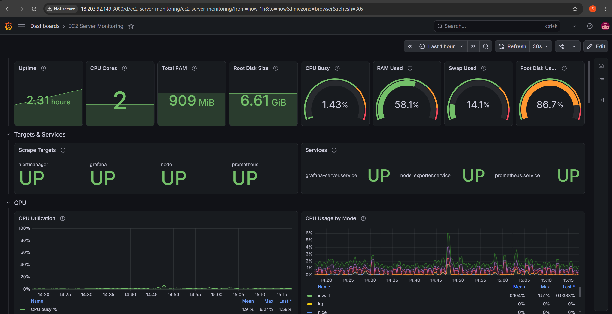
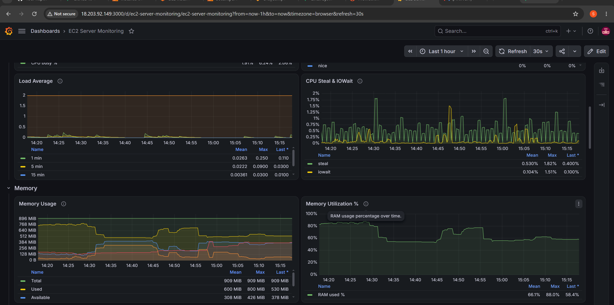
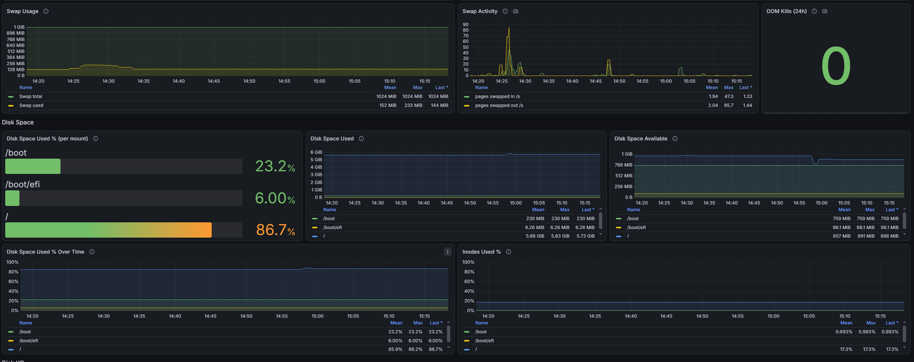
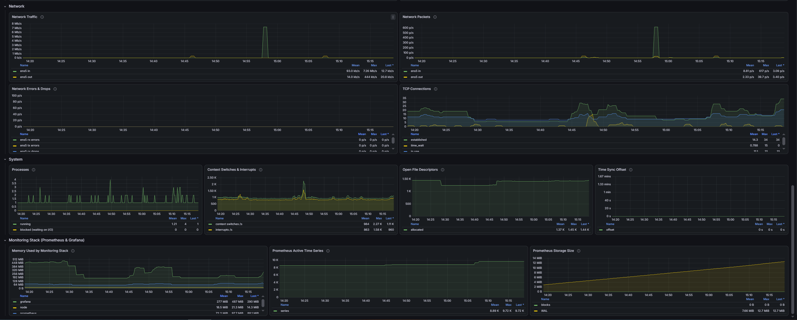
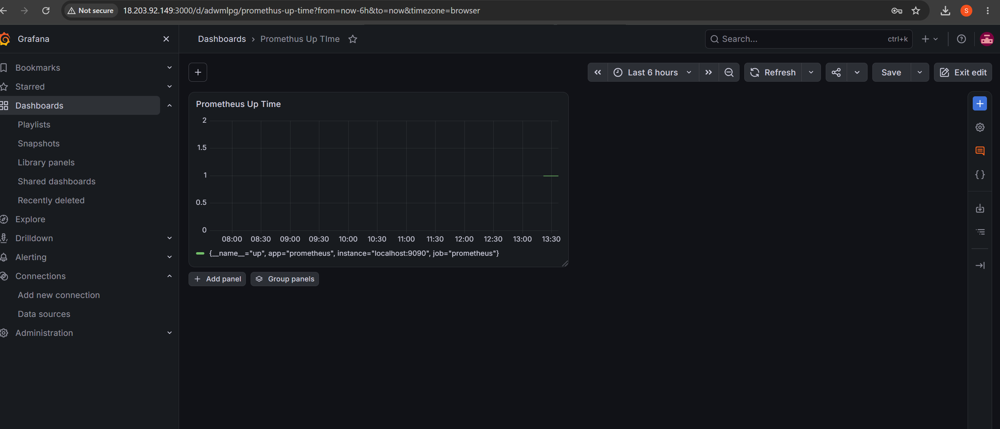

# Server Monitoring on AWS EC2 with Prometheus, Grafana, Node Exporter and Alertmanager

A complete, step-by-step monitoring setup for a single **AWS EC2 `t3.micro` Ubuntu server**:

- **Prometheus** collects and stores metrics.
- **Node Exporter** exposes the server's CPU, RAM, swap, disk, network and service metrics.
- **Grafana** shows everything in a 39-panel dashboard.
- **Alertmanager** sends **email alerts through Gmail** when RAM or disk usage gets too high.

Every command in the guides comes with an explanation, and every config file used on the server is in this repository.

---

## Screenshots

### EC2 Server Monitoring dashboard

Overview gauges, scrape targets, service status and CPU:



Load average, CPU steal/iowait and memory:



Swap, OOM kills and disk space (the root disk is at 86.7%, which triggers the disk alert):



Network, system and the monitoring stack itself:



### Alert rules in Grafana

`HighMemoryUsage` is Normal. `HighDiskUsage` is Pending (above 85%, waiting out the 5-minute `for:` period):


### Alert email received through Gmail

Subject: **`[FIRING:1] HighDiskUsage localhost:9100 (node_exporter /dev/root ext4 node / warning)`**


<details>
<summary>More screenshots</summary>

**Prometheus web UI**


**First Grafana panel: `up` query (Prometheus Up Time)**



</details>

---

## Architecture

```
 Your Laptop (browser) ── http://<EC2-Public-IP>:3000 ──┐   Security Group: 3000 (and optionally 9090) ← My IP only
                                                         ▼
 ┌──────────────────────── EC2 t3.micro · Ubuntu · 1 GB RAM + 1 GB swap ────────────────────────┐
 │                                                                                              │
 │   Grafana :3000 ──── queries ────► Prometheus :9090 ──── alerts ────► Alertmanager 127.0.0.1:9093
 │                                       │  scrapes every 15s                    │              │
 │                                       ├─► localhost:9090  (itself)            │              │
 │                                       ├─► localhost:9100  Node Exporter       │              │
 │                                       ├─► localhost:3000  Grafana             │              │
 │                                       └─► localhost:9093  Alertmanager        │              │
 │                                                                               │              │
 │   Node Exporter 127.0.0.1:9100 ◄── reads /proc, /sys, systemd                 │              │
 └───────────────────────────────────────────────────────────────────────────────┼──────────────┘
                                                                                 ▼ SMTP :587 (TLS)
                                                                          smtp.gmail.com ──► 📧
```

| Component | Port | Listens on | Open in the Security Group? |
|---|---|---|---|
| Grafana | 3000 | all interfaces | ✅ Yes, **My IP** only |
| Prometheus | 9090 | all interfaces | Optional (**My IP** only). Grafana uses `localhost`. |
| Node Exporter | 9100 | `127.0.0.1` | ❌ No |
| Alertmanager | 9093 | `127.0.0.1` | ❌ No |

---

## Setup guides (follow in this order)

| # | Guide | What it covers |
|---|---|---|
| 1 | [Prometheus_Installation_Steps.md](Prometheus_Installation_Steps.md) | Install Prometheus, the systemd service, the Security Group, public vs private IP, troubleshooting "This site can't be reached" |
| 2 | [Grafana_Installation_Steps.md](Grafana_Installation_Steps.md) | **Swap memory**, install Grafana from the APT repository, connect to Prometheus, first dashboard |
| 3 | [Node_Exporter_Installation_Steps.md](Node_Exporter_Installation_Steps.md) | Server metrics, the updated Prometheus config, importing the monitoring dashboard |
| 4 | [Alerting_Setup_Steps.md](Alerting_Setup_Steps.md) | Alertmanager, Gmail App Password, alert rules (RAM > 65%, Disk > 85%), test email |

---

## Repository structure

```
.
├── README.md                              ← you are here
├── Prometheus_Installation_Steps.md       ← guide 1
├── Grafana_Installation_Steps.md          ← guide 2
├── Node_Exporter_Installation_Steps.md    ← guide 3
├── Alerting_Setup_Steps.md                ← guide 4
├── .gitignore                             ← keeps passwords/backups out of Git
│
├── prometheus/                            ← Prometheus, Node Exporter and Alertmanager configs
│   ├── prometheus.yml
│   ├── prometheus.service
│   ├── alert_rules.yml
│   ├── node_exporter.service
│   ├── alertmanager.yml
│   └── alertmanager.service
│
├── grafana/                               ← Grafana dashboard and queries
│   ├── server-monitoring-dashboard.json
│   └── queries.md
│
├── screenshots/                           ← images used in this README and the guides
│
└── system/                                ← OS-level settings
    ├── fstab-swap.conf
    ├── 99-swappiness.conf
    └── grafana.list
```

---

## Config files and where they go on the server

| Repository file | Server location | Owner | Purpose |
|---|---|---|---|
| [`prometheus/prometheus.yml`](prometheus/prometheus.yml) | `/etc/prometheus/prometheus.yml` | `prometheus` | Scrape targets, rule files, Alertmanager address |
| [`prometheus/prometheus.service`](prometheus/prometheus.service) | `/etc/systemd/system/prometheus.service` | `root` | Runs Prometheus (15-day retention) |
| [`prometheus/alert_rules.yml`](prometheus/alert_rules.yml) | `/etc/prometheus/alert_rules.yml` | `prometheus` | `HighMemoryUsage` (> 65%) and `HighDiskUsage` (> 85%) alerts |
| [`prometheus/node_exporter.service`](prometheus/node_exporter.service) | `/etc/systemd/system/node_exporter.service` | `root` | Runs Node Exporter on `127.0.0.1:9100` with the systemd collector |
| [`prometheus/alertmanager.yml`](prometheus/alertmanager.yml) | `/etc/alertmanager/alertmanager.yml` | `alertmanager` | Gmail SMTP settings, routing, recipient |
| [`prometheus/alertmanager.service`](prometheus/alertmanager.service) | `/etc/systemd/system/alertmanager.service` | `root` | Runs Alertmanager on `127.0.0.1:9093` |
| *(not in repo, secret)* | `/etc/alertmanager/gmail_app_password` | `alertmanager`, mode `600` | Gmail App Password, created on the server only |
| [`grafana/server-monitoring-dashboard.json`](grafana/server-monitoring-dashboard.json) | Imported in the Grafana UI | — | "EC2 Server Monitoring" dashboard |
| [`grafana/queries.md`](grafana/queries.md) | Pasted into Grafana panels | — | Every PromQL query, with unit and visualization type |
| [`system/fstab-swap.conf`](system/fstab-swap.conf) | **Appended** to `/etc/fstab` | `root` | Turns swap on at boot |
| [`system/99-swappiness.conf`](system/99-swappiness.conf) | `/etc/sysctl.d/99-swappiness.conf` | `root` | (Optional) Prefer RAM over swap |
| [`system/grafana.list`](system/grafana.list) | `/etc/apt/sources.list.d/grafana.list` | `root` | Grafana APT repository |

### Copying a file to the server

The guides use **EC2 Instance Connect** (a browser terminal), so files are copied by pasting:

```bash
sudo nano /etc/prometheus/prometheus.yml     # open (or create) the target file
# paste the file contents, then: Ctrl+O, Enter, Ctrl+X
```

Then validate and apply:

| After changing | Validate | Apply |
|---|---|---|
| `prometheus.yml` / `alert_rules.yml` | `promtool check config /etc/prometheus/prometheus.yml` | `sudo systemctl reload prometheus` |
| `alertmanager.yml` | `amtool check-config /etc/alertmanager/alertmanager.yml` | `sudo systemctl reload alertmanager` |
| any `*.service` file | — | `sudo systemctl daemon-reload && sudo systemctl restart <service>` |

---

## What is monitored

| Area | Metrics |
|---|---|
| CPU | Utilization, usage by mode, load average, **steal** (t3 CPU credits), iowait |
| Memory | Used / available / free / cache, utilization %, **swap** usage and activity, OOM kills |
| Disk space | Used % per mount, used and available bytes, trend, inodes |
| Disk I/O | Busy %, throughput, IOPS, latency |
| Network | Traffic, packets, errors and drops, TCP connections |
| System | Uptime, processes, context switches, file descriptors, clock sync |
| Services | UP/DOWN for `prometheus`, `grafana-server`, `node_exporter`, `alertmanager` |
| Monitoring stack | RAM used by each component, Prometheus series count and storage size |

## Alerts

| Alert | Condition | Notification |
|---|---|---|
| `HighMemoryUsage` | RAM used > **65%** for 5 minutes | Email (FIRING + RESOLVED, reminder every 4 h) |
| `HighDiskUsage` | Any real filesystem > **85%** full for 5 minutes | Email (FIRING + RESOLVED, reminder every 4 h) |

---

## Lessons learned on a `t3.micro`

| Issue | What happened | Fix |
|---|---|---|
| "This site can't be reached" | The Prometheus binary was installed, but the **systemd service** was never created, so nothing was running | Create and start `prometheus.service` |
| Low memory | 1 GB of RAM is tight for Prometheus + Grafana | Add a **1 GB swap file** |
| `Disk quota exceeded` while downloading | On newer Ubuntu, `/tmp` is a small **RAM-based `tmpfs`** with a per-user limit, and old downloads had filled it. Swap does not raise this limit. | Download into the home folder (`~`) and delete archives after installing |
| Root disk 87% full | The default **8 GB EBS** volume plus 1 GB of swap plus Prometheus data | `apt clean`, shrink journald logs, or **grow the EBS volume** (`growpart` + `resize2fs`) |

---

## Security

- Every service runs as its **own non-login system user**, not root.
- Node Exporter and Alertmanager listen on **`127.0.0.1` only**.
- Security Group rules use **My IP** (`x.x.x.x/32`), never `0.0.0.0/0`.
- The Gmail **App Password** lives only on the server (`chmod 600`). It is **not** in this repository, and `.gitignore` blocks password files.

## Tech stack

Ubuntu on AWS EC2 · Prometheus 3.x · Node Exporter · Alertmanager · Grafana OSS · systemd · Gmail SMTP
